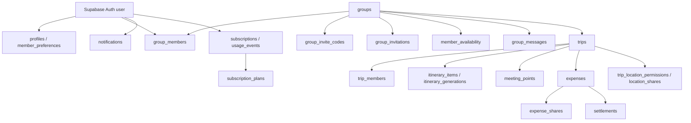

# AnoTara V2 — Database & Backend Integration Guide

**Audience:** AnoTara frontend, backend, QA, and project teammates  
**Version:** V2 | **Document date:** November 23, 2026  
**Database:** Supabase PostgreSQL, `public` schema; Supabase Auth (`auth.users`)  
**Deployment status:** V2 migration applied to the existing cloud project through the Supabase SQL Editor. The user's post-deployment read-only audit passed. This document describes the deployed SQL, not a new migration to execute.

> **DO NOT RUN THE V1 OR V2 MIGRATION AGAIN.** These SQL files are retained as implementation history. The V2 deployment script is guarded against reapplication. This document does not contain production credentials, user records, or backup data.

## Contents

1. [Overview and deployment status](#1-overview-and-deployment-status)
2. [Database table inventory (23 tables)](#2-database-table-inventory-23-tables)
3. [What's new in V2](#3-whats-new-in-v2)
4. [Business rules by feature](#4-business-rules-by-feature)
5. [Client-callable RPC function reference](#5-client-callable-rpc-function-reference)
6. [Internal database functions and triggers](#6-internal-database-functions-and-triggers)
7. [Access control and RLS](#7-access-control-and-rls)
8. [Flutter / Supabase integration examples](#8-flutter--supabase-integration-examples)
9. [What is implemented versus still required](#9-what-is-implemented-versus-still-required)
10. [Migrations, repository structure, and team handoff](#10-migrations-repository-structure-and-team-handoff)
11. [Verification snapshot and source files](#11-verification-snapshot-and-source-files)

---

## 1. Overview and deployment status

AnoTara is a group-trip planning app with **Organizer** and **Member** roles. V2 aligns the database more closely with the finalized Figma flows: date-specific availability, unique invitation codes, group conversations, trip RSVP changes, tracked repayments, leave/removal safeguards, location-sharing consent, and itinerary/notification/entitlement APIs.

### High-level change summary

| Metric | Before (V1) | After (V2) |
|---|---:|---:|
| `public` application tables | 18 | **23** |
| New tables | — | **5** |
| Newly authored/replaced function definitions in V2 deployment script | — | **42** (27 client-facing RPCs plus 15 internal/helper/trigger functions; includes replacement of `is_trip_member`) |
| Signup automation | Existing `on_auth_user_created` trigger | **Preserved**, not replaced |
| Production account and preference records | Existing records | **Preserved** in verification |

### Architectural map



**Key implementation principle:** For sensitive operations, Flutter calls authenticated `public.anotara_*` RPC functions. It should **not** directly insert/update/delete protected membership, invitation, expense, repayment, itinerary, or location tables. Read access is controlled by existing and updated RLS policies.

---

## 2. Database table inventory (23 tables)

**Legend:** **NEW** = table introduced by V2; **UPDATED** = V2 changes columns, constraints, permissions, policies, or feature behavior; **RETAINED** = pre-existing table still used in V2. Some retained tables have new access restrictions or workflows.

| Domain | Table | Classification | Purpose / V2 notes |
|---|---|---|---|
| Accounts | `profiles` | RETAINED | Public profile linked to `auth.users`; existing signup trigger remains. |
| Accounts | `member_preferences` | UPDATED | Dietary/activity/budget preferences; recurring `usual_free_days` retained for old Flutter functionality; group-visible preference reads tightened for departed members. |
| Subscriptions | `subscription_plans` | UPDATED | Free, Plus, Trip Pass catalog; client writes restricted. |
| Subscriptions | `subscriptions` | UPDATED | User's verified plan and validity period; client writes restricted. |
| Subscriptions/AI | `usage_events` | UPDATED | Usage-event audit, including AI generation quota; client writes restricted. |
| Groups | `groups` | UPDATED | Group details; creating user automatically gets organizer membership; financial-history deletion guard. |
| Groups | `group_members` | UPDATED | Organizer/member role plus `active`, `left`, `removed` state. |
| Groups | `group_invitations` | UPDATED | Named-user invitations with accept/decline and expiration, now via RPC. |
| Groups | `group_invite_codes` | **NEW** | One current share code per group, 12-character uppercase hex; seven-day issuance expiry. |
| Groups | `anotara_code_redeem_attempts` | **NEW** | Per-account code-redemption throttle window/counter. |
| Groups | `group_messages` | **NEW** | Persisted group chat messages and sender. |
| Groups/calendar | `member_availability` | **NEW** | Member availability on individual calendar dates. |
| Trips | `trips` | UPDATED | Upcoming/ongoing/completed/cancelled lifecycle; cancellation/completion metadata and time zone. |
| Trips | `trip_members` | UPDATED | Separate RSVP response and membership status; auto-add trip creator. |
| Trips/itinerary | `itinerary_items` | UPDATED | Activities and schedule; organizer mutations through RPCs. |
| Trips/itinerary | `itinerary_generations` | UPDATED | Queued AI itinerary requests and their results/status (AI worker external). |
| Trips | `meeting_points` | UPDATED | Trip meeting locations; organizer mutations through RPCs. |
| Finance | `expenses` | UPDATED | Expense owner, payer, amount, PHP currency; equal/custom splits only. |
| Finance | `expense_shares` | UPDATED | Per-member split, settled flag, and settlement time. |
| Finance | `settlements` | UPDATED | Repayment history linked back to the expense. |
| Locations | `location_shares` | UPDATED | Latest location per trip/user, only available under strict consent/RSVP/time controls. |
| Locations | `trip_location_permissions` | **NEW** | Explicit opt-in/out for each user on each trip. |
| Notifications | `notifications` | UPDATED | In-app notifications for invitations, added trip members, and group messages; mark-read RPC. |

### 2.1 Five newly introduced tables — key fields

| Table | Primary key | Key fields | Notes |
|---|---|---|---|
| `member_availability` | `(group_id, user_id, available_on)` | `status`, `updated_at` | `status`: `available`, `busy`, `not_available`, `maybe`; `(group_id,user_id)` also references existing group membership. |
| `group_invite_codes` | `group_id` | `code` (unique), `created_by`, `created_at`, `expires_at` | Exactly one stored code per group; code format `^[A-F0-9]{12}$`. |
| `group_messages` | `id` | `group_id`, `sender_id`, `message_text`, `created_at`, `edited_at` | Message length 1–5,000 characters. |
| `trip_location_permissions` | `(trip_id, user_id)` | `enabled`, `updated_at` | Defaults to `false`; foreign key to trip membership. |
| `anotara_code_redeem_attempts` | `user_id` | `window_started`, `attempt_count`, `last_attempt_at` | Server-managed; not readable/writable by the mobile client. |

### 2.2 Existing-table structural changes

| Existing table | Change in V2 |
|---|---|
| `trips` | `status` constrained to `upcoming`, `ongoing`, `completed`, `cancelled` (default `upcoming`). Adds `timezone_name` (default `Asia/Manila`), `cancelled_at`, `cancelled_by`, `cancellation_reason`, `completed_at`. |
| `trip_members` | `response` restricted to `pending`, `going`, `not_going` (no `maybe` RSVP). Adds `membership_status` (`active`, `left`, `removed`), `left_at`, `removed_at`. |
| `group_members` | `status` now accepts `active`, `left`, `removed`; existing role is `organizer` or `member`. |
| `expenses` | `split_method` now only `equal`/`custom`; `currency` normalized to `char(3)` with default `PHP`. |
| `settlements` | Adds nullable `expense_id` referencing `expenses(id)`; `currency` normalized to `char(3)` with default `PHP`. Adds uniqueness guard against duplicate paid repayments per expense/debtor. |
| `member_preferences` | Existing `usual_free_days` remains; **do not repurpose it** for the new multi-date group calendar. |

> V2 was built against the **actual deployed V1 schema**, which differed slightly from the older V1 fresh-install SQL. Treat that older original file as historical reference, not as an instruction to rebuild production.

---

## 3. What's new in V2

### 3.1 Membership and RSVP are separate concepts

- **Group role:** `organizer` or `member`.
- **Group membership:** `active`, `left`, or `removed` (`group_members.status`).
- **Trip membership:** `active`, `left`, or `removed` (`trip_members.membership_status`).
- **Trip RSVP:** `pending`, `going`, or `not_going` (`trip_members.response`).
- A user who selects **Not Going** is **still an active trip member**. Do not automatically remove them from the trip, hide the whole trip, or delete financial records.
- Users can switch **Going ↔ Not Going** on **upcoming and ongoing** trips. RSVP is locked once the trip is **completed or cancelled**.
- Live-location sharing is separate from membership and RSVP: **Not Going cannot view or publish active trip locations**.

### 3.2 Availability is per calendar date

Use `member_availability` for group availability:

```text
(group_id, user_id, 2026-12-05, available)
(group_id, user_id, 2026-12-06, busy)
```

A member may select multiple dates, with a different availability value for each. The composite primary key prevents duplicate date entries for the same user/group. **`maybe` is allowed for availability but not for trip RSVP.**

### 3.3 Group invitations have two mechanisms

1. **Share code:** Active organizer generates/rotates one current 12-character code, which expires seven days after issuance. Any signed-in eligible user can redeem it through the RPC. Revoked/removed members cannot rejoin via generic code. A previously **left** member may reactivate via valid code.
2. **Addressed invitation:** Organizer sends to a registered user. Only that invitee can accept/decline; a pending invitation is valid for seven days. Existing pending invitations are reused instead of duplicated.

Code redemption permits **five attempts per authenticated account per 15-minute window**. This is *not* IP/device-based rate limiting; stronger anti-abuse measures are a separate launch task.

---

## 4. Business rules by feature

### Groups and trips

- Group creation: authenticated user inserts a group; trigger adds creator as an **active organizer**.
- Trip creation: authenticated organizer creates a trip; trigger adds creator as an **active, Going** trip participant.
- Adding a trip participant: organizer can add an active group member to an upcoming/ongoing trip, initially as `pending`. Previously left/removed trip membership requires a separate review/re-invitation workflow.
- **Trip status transitions are manual via organizer RPC:** `upcoming → ongoing` or `cancelled`; `ongoing → completed` or `cancelled`. There is no built-in date-based automatic scheduler in this migration.
- Leaving/removing preserves membership rows and financial history (logical status change rather than hard-delete).

### Financial workflow

- New expenses only for **upcoming/ongoing** trips, added by an active trip member. The named payer must also be an active trip member.
- Split methods: **equal** or **custom**. Custom shares must total the expense exactly, to two decimal places. Equal splits distribute any remaining cents deterministically.
- The expense payer's own portion is considered already settled. Other nonzero shares remain outstanding until repayment confirmation.
- **The original payer**, not the debtor, verifies a repayment. This marks the share settled and inserts a record in `settlements` tied to `expense_id`.
- The **expense creator** may edit/delete only while the trip is open and **before a repayment is recorded**. Other users (including the organizer, if not the creator) do not automatically have this power.
- Completed/cancelled trips cannot accept new, edited, or deleted expenses; **existing debts can still be settled**.
- A user cannot leave a trip/group, or be removed, while that user **owes or is owed** an unsettled amount anywhere in the affected scope.
- An active organizer cannot leave their own group/trip via the member-leave RPCs. Organizer transfer is not implemented.
- Deleting a trip/group with expense history is blocked until a deliberate retention/export workflow exists.
- **No partial repayment, dispute, reversal, or refund workflow** is implemented.

### Itinerary and meeting points

- Active group organizers can add/edit/delete itinerary activities and meeting points for **upcoming/ongoing** trips.
- Itinerary item fields include title, optional schedule, location/address/coordinates, category, description, estimated cost, and sort order.
- Reading itinerary and meeting-point rows still depends on the respective SELECT/RLS policies.
- Calling the AI request RPC queues a request; **it does not create an AI-generated itinerary automatically**.

### Group messaging and notifications

- Active group members may read group chat and send via `anotara_send_group_message`.
- Message text: 1–5,000 trimmed characters. Throttle: **15 messages per sender per group within 60 seconds**.
- Message editing/deleting is not enabled by the initial V2 API.
- Database triggers generate **in-app** notification rows when an addressed invitation is sent, a participant is added to a trip (excluding its creator), or a group message is posted (other active group members only).
- Mark notifications read with `anotara_mark_notifications_read` (selected IDs or all unread items).
- **Push notifications are not automatically delivered**; FCM/APNs or equivalent delivery infrastructure is separate.

### Live location and consent

- The user independently opts in using `anotara_set_location_consent`; consent is **off by default**.
- Enabling consent requires active group/trip membership, RSVP `going`, and upcoming/ongoing trip.
- Publishing actual coordinates requires an **ongoing** trip, RSVP `going`, active memberships, and enabled consent.
- Reading another person's live location additionally requires the **viewer** to be an active `going` trip participant and the **sharer** to remain `going` with consent enabled.
- Location rows expire for **client visibility after two minutes**; the latest row is updated per user/trip.
- Disabling consent, leaving/removal, or completing/cancelling a trip disables active location sharing.
- **Expired database records are not automatically deleted.** Mobile permissions, background behavior, retention cleanup, and privacy review remain to be implemented.

### Subscriptions and AI quotas

The existing V1 seed configuration defines these reference plans (confirm actual values in `subscription_plans` when displaying production prices/limits):

| Plan | Display price | Max groups | Max group members | Max active trips | AI requests / plan window |
|---|---:|---:|---:|---:|---:|
| Free | ₱0 | 1 | 8 | 1 | 3 |
| Plus | ₱199/month | 10 | 20 | 5 | 20 |
| Trip Pass | ₱99/pass | 1 | 8 | 1 | 5 |

- `anotara_current_entitlements` returns an active, unexpired verified subscription's limits; falls back to Free otherwise.
- AI request accounting uses the calendar month for Free/Plus and the subscription period for Trip Pass.
- Group/member/trip quotas are **reported** but are **not consistently enforced in all creation/join RPCs** yet.
- The SQL does **not** charge users or verify payment-provider transactions. A trusted service must activate subscriptions.
- The AI quota is charged when the request is queued. Model inference, output handling, and failed-request quota/refund policy must be implemented separately.

---

## 5. Client-callable RPC function reference

The deployed V2 SQL defines **27 primary RPCs** for authenticated application use. Call using `supabase.rpc('<function_name>', params: {...})` in Flutter, or POST to `/rest/v1/rpc/<function_name>` with the user's JWT. Parameter names shown below are **exact SQL names**. Optional SQL parameters have defaults.

### 5.1 Groups, invitations, and RSVP (6 RPCs)

| Function | Parameters | Returns | Purpose / authorization |
|---|---|---|---|
| `anotara_rotate_group_invite_code` | `p_group_id uuid` | Rows containing `invite_code`, `expires_at` | Active organizer issues/replaces one current code, seven-day expiration. |
| `anotara_redeem_group_code` | `p_code text` | `jsonb` | Signed-in user redeems code; returns `success`, message and group details; limited attempts. |
| `anotara_send_group_invitation` | `p_group_id uuid`, `p_invitee_user_id uuid` | `uuid` | Active organizer invites existing registered user. |
| `anotara_respond_group_invitation` | `p_invitation_id uuid`, `p_accept boolean` | `text` | Invitee accepts/declines their own invitation. |
| `anotara_add_trip_participant` | `p_trip_id uuid`, `p_user_id uuid` | `text` | Organizer adds active group member to an open trip (`added`, `already_member`, or `membership_review_required`). |
| `anotara_set_trip_rsvp` | `p_trip_id uuid`, `p_response text` | `text` | Member sets own RSVP to `going` or `not_going` for upcoming/ongoing trip. |

### 5.2 Expenses and departures (8 RPCs)

| Function | Parameters | Returns | Purpose / authorization |
|---|---|---|---|
| `anotara_create_expense` | `p_trip_id uuid`, `p_description text`, `p_amount numeric`, `p_paid_by uuid`, `p_split_method text`, `p_members jsonb`, `p_category text = NULL`, `p_notes text = NULL` | `uuid` | Creates expense and all shares atomically; signed-in active trip member. |
| `anotara_edit_expense` | `p_expense_id uuid`, `p_description text`, `p_amount numeric`, `p_split_method text`, `p_members jsonb`, `p_category text = NULL`, `p_notes text = NULL` | `void` | Expense creator only, on open trip, before repayments. |
| `anotara_delete_expense` | `p_expense_id uuid` | `void` | Creator only, no prior repayments, open trip. |
| `anotara_confirm_repayment` | `p_expense_id uuid`, `p_debtor_id uuid` | `uuid` | Original payer confirms debtor's full share; inserts settlement. |
| `anotara_leave_trip` | `p_trip_id uuid` | `text` | Active non-organizer leaves open trip if no financial obligations. |
| `anotara_leave_group` | `p_group_id uuid` | `text` | Regular member leaves group and associated trips if fully settled. |
| `anotara_remove_trip_participant` | `p_trip_id uuid`, `p_user_id uuid` | `text` | Organizer removes non-organizer from open trip after debts/receivables clear. |
| `anotara_remove_group_member` | `p_group_id uuid`, `p_user_id uuid` | `text` | Organizer removes active regular member from group and its trips after financial clearance. |

**Exact `p_members` payload format:**

**Equal split** — include every participant:

```json
[{"user_id":"USER_UUID_1"},{"user_id":"USER_UUID_2"}]
```

**Custom split** — amounts must total the expense:

```json
[{"user_id":"USER_UUID_1","amount":60.00},{"user_id":"USER_UUID_2","amount":60.00}]
``` The expense RPC itself checks participant membership, cent precision, duplicates, and exact custom totals.

### 5.3 Itineraries and meeting points (6 RPCs)

| Function | Required parameters | Optional parameters (SQL defaults) | Returns |
|---|---|---|---|
| `anotara_add_itinerary_item` | `p_trip_id uuid`, `p_title text` | `p_starts_at`, `p_ends_at`, `p_location_name`, `p_description`, `p_category`, `p_address`, `p_latitude`, `p_longitude`, `p_estimated_cost` (all nullable); `p_sort_order integer = 0` | `uuid` |
| `anotara_update_itinerary_item` | `p_item_id uuid`, `p_title text` | Same optional fields/defaults as add | `boolean` |
| `anotara_delete_itinerary_item` | `p_item_id uuid` | — | `boolean` |
| `anotara_add_meeting_point` | `p_trip_id uuid`, `p_name text`, `p_latitude double precision`, `p_longitude double precision` | `p_address`, `p_scheduled_at`, `p_notes` (nullable) | `uuid` |
| `anotara_update_meeting_point` | `p_point_id uuid`, `p_name text`, `p_latitude double precision`, `p_longitude double precision` | Same optional fields/defaults as add | `boolean` |
| `anotara_delete_meeting_point` | `p_point_id uuid` | — | `boolean` |

All six require an **active group organizer** managing an **upcoming or ongoing** trip. For updates, unspecified optional fields use their SQL defaults (`NULL`/0) and therefore may **clear existing values**; the frontend should send the complete desired item, not assume a partial patch.

### 5.4 Chat, notifications, and live location (4 RPCs)

| Function | Parameters | Returns | Purpose |
|---|---|---|---|
| `anotara_send_group_message` | `p_group_id uuid`, `p_message_text text` | `uuid` | Active group member sends a persisted message (rate limited). |
| `anotara_mark_notifications_read` | `p_ids uuid[] = NULL` | `integer` | Marks own notifications as read; `NULL` means **all** unread notifications for the caller. |
| `anotara_set_location_consent` | `p_trip_id uuid`, `p_enabled boolean` | `boolean` | Caller opts in/out; eligibility checks. |
| `anotara_publish_live_location` | `p_trip_id uuid`, `p_latitude double precision`, `p_longitude double precision`, `p_accuracy_meters numeric = NULL` | `uuid` | Publishes current location with 2-minute visibility TTL. |

### 5.5 Trip lifecycle, subscriptions, and AI (3 RPCs)

| Function | Parameters | Returns | Purpose |
|---|---|---|---|
| `anotara_change_trip_status` | `p_trip_id uuid`, `p_new_status text`, `p_cancellation_reason text = NULL` | `text` | Organizer transitions trip lifecycle and disables location on closure. |
| `anotara_current_entitlements` | *none* | `jsonb` | Caller retrieves current plan/limits; Free fallback. |
| `anotara_request_itinerary_generation` | `p_trip_id uuid`, `p_input_data jsonb = '{}'` | `uuid` | Organizer queues request and logs AI usage; does **not** generate itinerary content by itself. |

**RPC count:** 6 + 8 + 6 + 4 + 3 = **27**.

---

## 6. Internal database functions and triggers

These functions support security, data consistency, and automatic events. They are **not regular frontend write endpoints**. Some boolean predicates are executable by `authenticated` because RLS policies require them; that does not make them business-action RPCs.

### 6.1 Internal/helper functions (15)

| Function | Role |
|---|---|
| `is_trip_member(uuid)` | Existing V1 helper **replaced**: membership is active even when RSVP is `not_going`. |
| `anotara_prevent_financial_history_delete()` | Trigger helper blocks deleting trips/groups that contain expenses. |
| `anotara_touch_updated_at()` | Trigger helper refreshes timestamps. |
| `anotara_add_group_creator()` | Automatically creates organizer membership. |
| `anotara_add_trip_creator()` | Automatically creates Going trip membership. |
| `anotara_has_unsettled_trip_obligations(uuid,uuid)` | Internal unpaid debt/receivable check. |
| `anotara_has_unsettled_group_obligations(uuid,uuid)` | Internal check across a group's trips. |
| `anotara_replace_expense_shares(uuid,uuid,uuid,numeric,text,jsonb)` | Rebuilds validated equal/custom shares atomically. |
| `anotara_p3_active_group_member(uuid)` | Predicate for active group membership. |
| `anotara_p3_manage_trip(uuid)` | Predicate for organizer's ability to manage open trip. |
| `anotara_p3_active_trip_member(uuid)` | Predicate for active membership in a trip. |
| `anotara_p3_can_read_location(uuid,uuid)` | Predicate enforcing viewer/sharer RSVP, membership, status, and consent. |
| `anotara_p3_invitation_notify()` | Trigger helper inserts group-invite notification. |
| `anotara_p3_trip_member_notify()` | Trigger helper inserts trip-added notification. |
| `anotara_p3_message_notify()` | Trigger helper inserts group-message notifications. |

**Other existing V1 functions are retained**, including `handle_new_user()` and the existing signup trigger. The V2 script does not reproduce/replace the authentication helper functions wholesale. Inspect actual database metadata for the exhaustive set of legacy V1 functions.

### 6.2 Triggers added by V2 (16)

| Trigger | Table | Effect |
|---|---|---|
| `anotara_new_group_creator` | `groups` | Auto-add creator as organizer after insert. |
| `anotara_new_trip_creator` | `trips` | Auto-add creator as active Going participant. |
| `anotara_keep_trip_financial_history` | `trips` | Block deletion when expense history exists. |
| `anotara_keep_group_financial_history` | `groups` | Block deletion when any associated trip has expenses. |
| `anotara_groups_touch` | `groups` | Maintain `updated_at`. |
| `anotara_group_members_touch` | `group_members` | Maintain `updated_at`. |
| `anotara_trips_touch` | `trips` | Maintain `updated_at`. |
| `anotara_trip_members_touch` | `trip_members` | Maintain `updated_at`. |
| `anotara_expenses_touch` | `expenses` | Maintain `updated_at`. |
| `anotara_expense_shares_touch` | `expense_shares` | Maintain `updated_at`. |
| `anotara_settlements_touch` | `settlements` | Maintain `updated_at`. |
| `anotara_member_availability_touch` | `member_availability` | Maintain `updated_at`. |
| `anotara_location_permissions_touch` | `trip_location_permissions` | Maintain `updated_at`. |
| `anotara_p3_invitation_notification` | `group_invitations` | Create in-app invite notification. |
| `anotara_p3_trip_member_notification` | `trip_members` | Create in-app added-to-trip notification. |
| `anotara_p3_message_notification` | `group_messages` | Create in-app message notification. |

**Preserved V1 trigger:** `on_auth_user_created` on `auth.users` invokes `handle_new_user()` to create a `profiles` row on signup.

---

## 7. Access control and RLS

V2 keeps **Row Level Security (RLS)** enabled for public tables. Most sensitive mutation operations are restricted by SQL `REVOKE`s and exposed via validated `SECURITY DEFINER` RPCs, so merely having table-level RLS is not enough to determine client write access.

| Data / operation | Frontend approach | Important restrictions |
|---|---|---|
| Auth and own profile/preferences | Existing Supabase Auth and existing RLS-protected reads/edits | **Keep working signup/profile/preferences code intact**; verify against live API after deployment. |
| Group and trip creation | Existing authenticated direct INSERT with `created_by` = current user | Database triggers create organizer/participant rows. The previously observed `insert(...).select()` return-path issue needs frontend handling. |
| Group/trip memberships | **RPC only** | No general-purpose direct client INSERT/UPDATE/DELETE. |
| Named invitations and invite codes | **RPC only** | Only authorized organizers invite/rotate; only invitees respond; redemption rate limited. |
| Date availability | Direct `member_availability` INSERT/UPDATE/DELETE, RLS-protected | User may change **their own** dates only; group members can read active members' date availability. |
| Expenses, shares, settlements | **RPC only** | No direct client mutation. |
| Itinerary items, AI requests, meeting points | **RPC only for writes** | Organizer-only mutations; reads depend on existing SELECT policies. |
| Group chat | `anotara_send_group_message` RPC; direct SELECT | Only active group members. |
| Notifications | `anotara_mark_notifications_read` RPC; direct SELECT | Users only see/read their own notifications; no direct arbitrary writes. |
| Live-location consent and location updates | **RPC only**; direct SELECT subject to strict RLS | Going + active + ongoing + consent, recent location only. |
| Subscriptions, plans, usage events | Read entitlements RPC / authorized reads; trusted server writes | Client cannot self-award paid subscriptions or AI credits. |

**Do not bypass RLS using a service-role key from Flutter.** Only the anon/publishable key and signed-in user session belong in client apps. Service-role/secret credentials are server-only.

### Known security/production caveats

- Earlier V1 SELECT policies survive in some tables; permissions and privacy should be reviewed together, not inferred just from an installation PASS.
- The code-redemption limiter is per user, not IP or device; add API/WAF abuse protection when publicly launched.
- No automated cleanup of expired location records is included.
- Subscription quotas are not comprehensively enforced for every group/trip/join write path.
- A successful migration or installation audit **does not** replace full two-user and adversarial RLS testing.

---

## 8. Flutter / Supabase integration examples

These are **illustrative Dart snippets** assuming your app already has a configured `SupabaseClient` named `supabase`. Replace placeholder IDs with actual IDs from the signed-in user's authorized data.

### 8.1 Redeem a group code

```dart
final response = await supabase.rpc(
  'anotara_redeem_group_code',
  params: {'p_code': typedCode.trim()},
);

if (response['success'] == true) {
  final joinedGroupId = response['group_id'];
  // Refresh the user's group list.
} else {
  // Display response['message'].
}
```

### 8.2 Save a specific availability date

```dart
final userId = supabase.auth.currentUser!.id;

await supabase.from('member_availability').upsert(
  {
    'group_id': groupId,
    'user_id': userId,
    'available_on': '2026-12-05',
    'status': 'available',
  },
  onConflict: 'group_id,user_id,available_on',
);
```

### 8.3 Update own trip RSVP

```dart
await supabase.rpc(
  'anotara_set_trip_rsvp',
  params: {
    'p_trip_id': tripId,
    'p_response': 'not_going', // or 'going'
  },
);
```

### 8.4 Create an equal-split expense

```dart
final expenseId = await supabase.rpc(
  'anotara_create_expense',
  params: {
    'p_trip_id': tripId,
    'p_description': 'Lunch',
    'p_amount': 120.00,
    'p_paid_by': payerUserId,
    'p_split_method': 'equal',
    'p_members': [
      {'user_id': payerUserId},
      {'user_id': otherUserId},
    ],
  },
);
```

### 8.5 Set live-location consent

```dart
await supabase.rpc(
  'anotara_set_location_consent',
  params: {
    'p_trip_id': tripId,
    'p_enabled': true,
  },
);
```

**Integration reminders:**

- Handle both database exceptions and RPC-returned `success: false` responses (especially code redemption).
- The SQL Editor uses privileged database access; a successful SQL Editor query **does not demonstrate** that the same operation is allowed through an authenticated Flutter client.
- Group/trip creation previously succeeded with `return=minimal` but failed in the immediate `return=representation` path during local testing. Avoid assuming `.insert(...).select()` works without validating the current API policies and transaction behavior.
- `anotara_current_entitlements` returns limits but is not a replacement for server-side quota enforcement.
- Use Supabase Realtime subscriptions and an appropriate push provider if the UI requires immediate chat/notification delivery.

---

## 9. What is implemented versus still required

| Area | V2 SQL | Remaining work before full feature launch |
|---|---|---|
| Auth/profile compatibility | Existing signup trigger and data preserved | Run smoke tests in actual Flutter app. |
| Groups/invitations/RSVP | RPCs installed; Phase 2 local integration suite passed | Flutter screens, UI error states, re-invitation edge cases. |
| Expense/repayment/departures | RPCs installed; Phase 2 local integration suite passed | Payment proof/partial repayments/disputes if required by product. |
| Calendar availability | Table/RLS and multi-user local tests passed | Flutter date-selection UX and display. |
| Itinerary/meeting points | Organizer RPCs installed | Full client workflows and validation; test Phase 3 behavior. |
| Chat/notifications | Message and in-app notification SQL installed | Realtime subscriptions, mobile push, full behavior tests. |
| Location sharing | Consent and short-lived read policy installed | Permissions UX, background handling, retention cleanup, privacy/security testing. |
| Plan entitlements | Lookup + AI quota accounting installed | Real payment provider, verification/webhooks, quota enforcement on all creation paths. |
| AI itinerary generation | Request queue & usage event installed | Trusted AI service/worker, output validation, failure handling. |
| Operations | V2 cloud install verified | Migration-history reconciliation, recovery plan, ongoing monitoring, Flutter integration. |

**Deployment is not the same as feature completion.** The SQL installed successfully and a minimal production audit passed; these outstanding items should be tracked by the team.

---

## 10. Migrations, repository structure, and team handoff

Suggested repo organization:

```text
anotara/
├── lib/
├── supabase/
│   ├── migrations/
│   │   └── 20261123000000_anotara_v2_production.sql
│   └── documentation/
│       └── anotara_v1_original_schema.sql
├── docs/
│   └── ANOTARA_V2_DATABASE_DOCUMENTATION.md
└── pubspec.yaml
```

- **V1 original schema:** historical fresh-install reference. **Do not run against V2 production.** It differs in places from the actual prior V1 database.
- **V2 consolidated migration:** exact historical upgrade source for V1 → V2. **Already applied through SQL Editor. Do not rerun.**
- **This Markdown:** teammate handoff for understanding and using the V2 backend; it is **not SQL**.
- **Migration history caution:** SQL executed manually in Supabase Studio is **not automatically entered** into the Supabase CLI migration ledger. Check `supabase migration list` and reconcile with your team's process before using `supabase db push`, `db reset`, or CI migration automation. Never mark V1 as applied merely because an older reference file exists.
- **Keep private data out of Git:** do not commit `schema.sql`/`data.sql`/`auth_data.sql` backup exports, JWTs, service-role secrets, or actual member data. Schema-only migration SQL may be committed to an appropriately controlled source repository.

### Suggested team handoff ownership

| Role | First task |
|---|---|
| Frontend (Flutter) | Map Organizer and Member Figma screens to queries/RPCs listed in section 5; preserve current Auth/preferences flow. |
| Backend/Supabase | Confirm all RLS/EXECUTE policies, inspect outstanding quota/permission edge cases, maintain migration tracking. |
| AI/payment services | Implement trusted AI queue processor and verified payment/webhook flows; never trust client-side entitlement changes. |
| QA | Perform Flutter end-to-end and privacy/security checks, especially Not Going/left/removed, expense blocking, and live location. |

---

## 11. Verification snapshot and source files

### Recorded production verification after V2 deployment

| Read-only check | Recorded result |
|---|---|
| Public tables | **23** |
| Existing profiles preserved | **12** |
| Existing member preferences preserved | **7** |
| Subscription plans preserved | **3** |
| Availability and chat installed | `true` |
| Invite redemption guard installed | `true` |
| Repayment RPC installed | `true` |
| Trip status RPC installed | `true` |
| Existing Auth signup trigger preserved | `true` |

### Tests performed during development

- Local Phase 2 acceptance: **11 initial passing checks** and **14 resumed passing checks** after the original expense-share response-count test was corrected. Expense shares were independently checked as two ₱60 shares on a ₱120 test expense.
- Local Phase 3: **five installation checks passed**, including function/trigger presence and important permissions. 
- Production: read-only post-deployment table, data-count, and object-presence audit passed.

### IMPORTANT REMINDER
**Maintainer note:** Update this guide whenever the schema or RPC contract changes. Do not quietly edit a migration already applied to production: add a **new timestamped migration** for subsequent schema changes, then document the change here.
